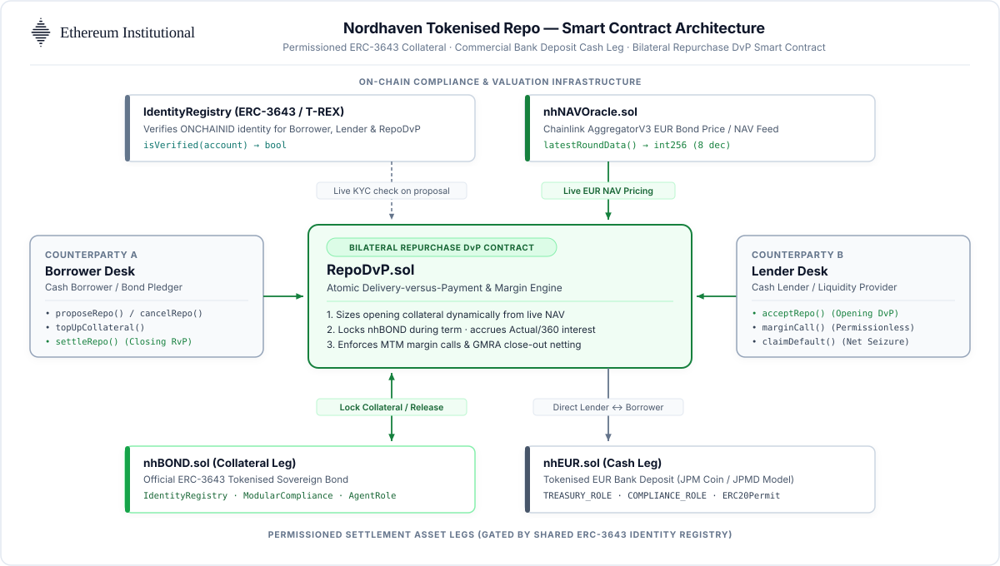

# Nordhaven Bank — Tokenised Repo on Ethereum (Atomic DvP)

> **Ethereum Institutional** · Bilateral Repurchase Agreement Prototype on Ethereum

Smart contracts and settlement console for tokenised EUR sovereign bond repurchase agreements (`RepoDvP`) with atomic Delivery-versus-Payment (DvP), Actual/360 per-second interest accrual, mark-to-market margin calls, and GMRA close-out netting on Ethereum.




## Case Study Deliverables

- **Part 1 — Concept Explainer (Trading Desk):** [`docs/CONCEPT_EXPLAINER.md`](docs/CONCEPT_EXPLAINER.md)
- **Part 2 — Considerations & Decision Memo:** [`docs/STEERING_COMMITTEE_MEMO.md`](docs/STEERING_COMMITTEE_MEMO.md)
- **Part 3 — Architecture & Design Notes:** [`docs/ARCHITECTURE_SPEC.md`](docs/ARCHITECTURE_SPEC.md) · [`docs/ARCHITECTURAL_NOTES.md`](docs/ARCHITECTURAL_NOTES.md) · [`app/README.md`](app/README.md)

## Contracts & Key Assumptions

| Contract                                 | Standard / Model          | Purpose                                                                 | Sepolia Address         |
| :--------------------------------------- | :------------------------ | :---------------------------------------------------------------------- | :---------------------- |
| [`RepoDvP.sol`](src/RepoDvP.sol)         | Bilateral Repo DvP        | Atomic DvP/RvP, Actual/360 interest, margin calls, default netting      | `TBD_ON_SEPOLIA_DEPLOY` |
| [`nhBOND.sol`](src/nhBOND.sol)           | Official ERC-3643 (T-REX) | Tokenised EUR sovereign bond, KYC-gated transfers                       | `TBD_ON_SEPOLIA_DEPLOY` |
| [`nhEUR.sol`](src/nhEUR.sol)             | Tokenised Bank Deposit    | Permissioned EUR cash leg (JPM Coin model) sharing `IdentityRegistry`   | `TBD_ON_SEPOLIA_DEPLOY` |
| [`nhNAVOracle.sol`](src/nhNAVOracle.sol) | Chainlink `AggregatorV3`  | Calculation-agent EUR NAV feed (8 decimals)                             | `TBD_ON_SEPOLIA_DEPLOY` |
| `IdentityRegistry`                       | Official ERC-3643 (T-REX) | On-chain `ONCHAINID` verification enforced by both tokens and `RepoDvP` | `TBD_ON_SEPOLIA_DEPLOY` |

**Three core architectural calls:**

1. **On-Chain Collateral Lock in `RepoDvP`:** Opening leg locks `nhBOND` inside `RepoDvP` rather than transferring to the lender's wallet, preventing rehypothecation or lender-freeze from blocking atomic closing-leg return (`settleRepo`).
2. **Borrower Proposal & Live NAV Sizing:** Borrower proposes terms (`initialMarginBps`, `maxCollateralAmount` slippage cap) naming the `lender`; `acceptRepo` sizes collateral dynamically at the live oracle NAV.
3. **GMRA Close-Out Netting:** On missed maturity or uncured margin call (`claimDefault`), the lender seizes collateral worth the exact accrued repurchase price (`amountOwed`) and any surplus is returned to the borrower.

---

## 1. Prerequisites & Tests

Requires [Foundry](https://getfoundry.sh/) and Node.js >= 18.

```bash
npm install && npm --prefix app install
forge build
forge test
```

Runs 50 unit, integration, fuzz (5,000 runs), and invariant (512 runs) tests across ERC-3643 compliance, atomic DvP/RvP, margin cures, and default netting.

---

## 2. Option A — Local Run (Anvil + Settlement Console)

Run the entire stack locally on chain ID `31337` with zero configuration:

```bash
# Terminal 1: start local Anvil node
make local-chain

# Terminal 2: deploy contracts, onboard default desks, and write app/.env.local
make local-deploy

# Terminal 2: start the web console (http://localhost:5173)
npm run app:dev
```

Import the three Anvil test keys printed by `make local-deploy` into MetaMask:

- **Account #0 (Operator):** Connects to **Market** (updates bond NAV) & **Identity** (KYC onboarding).
- **Account #1 (Borrower):** Connects to **Borrower** (pre-funded with 250,000 `nhBOND` + 25M `nhEUR`).
- **Account #2 (Lender):** Connects to **Lender** (pre-funded with 25M `nhEUR`).

---

## 3. Option B — Use Against Deployed Sepolia Contract

### Connect the UI to an existing Sepolia deployment

1. Remove any local override and configure `app/.env`:
   ```bash
   rm -f app/.env.local
   cp app/.env.example app/.env
   ```
2. Set `VITE_REPO_DVP=<SEPOLIA_REPO_DVP_ADDRESS>` (and optionally `VITE_RPC_URL` and `VITE_DEPLOY_BLOCK`) in `app/.env`.
3. Start the console:
   ```bash
   npm run app:dev
   ```
4. **Onboard a wallet:** Connect the deployer wallet on the **Identity** tab (`#/identity`) to one-click register and fund any Sepolia address, or run via CLI:
   ```bash
   REPO_DVP=0x... DESK=0x... BONDS=250000 CASH=25000000 \
   forge script script/deploy/OnboardDesk.s.sol --rpc-url $SEPOLIA_RPC_URL --broadcast
   ```

### Deploy a fresh instance to Sepolia

```bash
cp .env.example .env   # set SEPOLIA_RPC_URL, PRIVATE_KEY, ETHERSCAN_API_KEY, and optional BORROWER_ADDRESS / LENDER_ADDRESS

forge script script/deploy/DeployAll.s.sol \
  --rpc-url $SEPOLIA_RPC_URL \
  --broadcast \
  --verify \
  --etherscan-api-key $ETHERSCAN_API_KEY
```

_(If `nhBOND` verification is skipped during broadcast due to the `solc 0.8.17` `deployCode` bridge, run the `forge verify-contract` command printed at the end of the deploy log.)_
