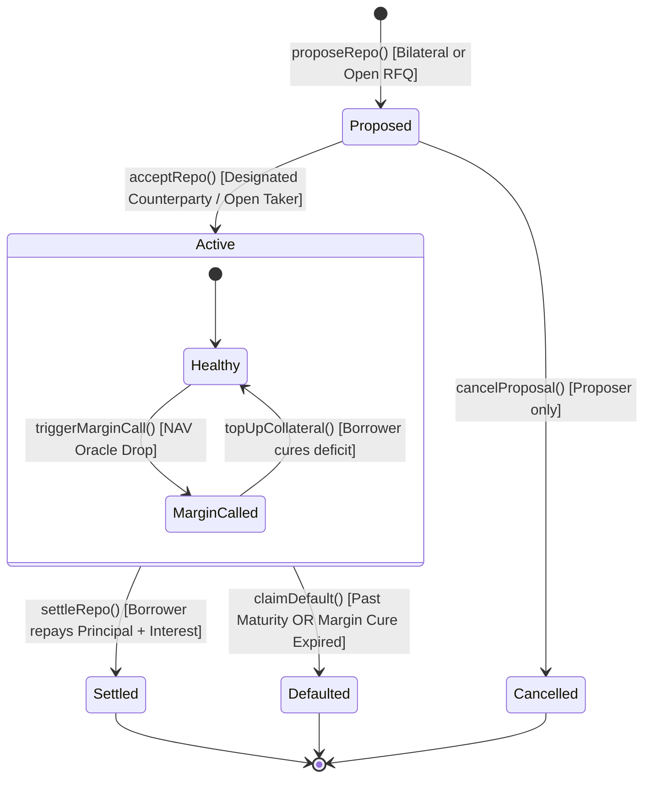

# Institutional DvP Repo Protocol: Architecture & Technical Specification

**Client:** Nordhaven Bank (European G-SIB)  
**Author:** Lead Forward Deployed Engineer (FDE), Ethereum Institutional (EI)  
**Target Deployment:** Ethereum Sepolia Testnet  
**Target Solc:** `0.8.34` (EVM Version: Cancun)  

---

## 1. Executive Summary & Business Context

Nordhaven Bank’s Treasury and Securities Financing desk operates an institutional bilateral and tri-party repurchase agreement (repo) book against European government bonds. In traditional financial market infrastructures (FMIs), this operation faces four structural bottlenecks:
1. **Settlement Latency & Rigid Market Cut-offs:** Settlement windows are strictly tied to TARGET2 and Euroclear/Clearstream operating hours, restricting intraday liquidity and collateral mobility.
2. **Counterparty & Settlement Failure Risk:** Fragmented clearing cycles where cash and collateral do not move simultaneously on a real-time gross basis (absence of true 24/7 atomic DvP Model 1).
3. **Manual Margin Management:** Mark-to-market calculations and margin call notices involve cumbersome multi-hour operational lags and manual collateral reconciliation.
4. **Trapped Inventory:** High-Quality Liquid Assets (HQLA) sovereign bonds remain stranded in designated clearing silos instead of being mobilized dynamically for intraday liquidity.

This architecture specifies a **24/7, atomic Delivery-versus-Payment (DvP) repurchase agreement engine on public Ethereum (Sepolia)**. It integrates three battle-tested institutional pillars:
- **Collateral Leg (`nhBOND NAV`):** Strictly implemented using the official **ERC-3643 (T-REX)** token standard, representing tokenised European sovereign bond units valued at continuous Net Asset Value (**`nhBOND NAV`**), incorporating on-chain identity verification (`ONCHAINID`), claim topics, and modular compliance rules.
- **Cash Leg (`nhEUR`):** Structured as a **Tokenised Commercial Bank Deposit** strictly modeled after **J.P. Morgan’s JPM Coin (`JPMD`)** (deployed on Ethereum Mainnet at `0xb2906cCED1b2c8330480414CeFA1eb52bDBd73A3`), featuring 4-tier banking controls and EIP-2612 gasless atomic permit capabilities.
- **Real Fund NAV Oracle (`nhNAVOracle`):** A production-grade Net Asset Value (NAV) Oracle modeling real-world tokenized money market funds (**BlackRock BUIDL**, **Ondo OUSG**, and **VanEck VBILL**), exposing Chainlink’s `AggregatorV3Interface` with calculation agent attestation, staleness heartbeats, and volatility circuit breakers.
- **Settlement & Escrow Engine (`RepoDvP`):** Operating as a decentralized tri-party collateral agent with EIP-712 zero-transaction off-chain order execution, Actual/360 money market interest accrual, and programmatic margin management.

---

## 2. System Architecture & Topology

```
                                  Institutional Trading & Settlement Layer
    ┌─────────────────────────────────────────────────────────────────────────────────────────────────┐
    │                                                                                                 │
    │     [ Bank A Trading Desk ]                                         [ Bank B Trading Desk ]     │
    │     (Cash Borrower / Pledgor)                                       (Cash Lender / Buyer)       │
    │                │                                                               │                │
    │                │  1. Propose repo trade on-chain via proposeRepo()             │                │
    │                └───────────────────────────────┬───────────────────────────────┘                │
    │                                                │                                                │
    │                                                │ 2. Submits acceptRepo()                        │
    │                                                ▼                                                │
    │                              ┌───────────────────────────────────┐                              │
    │                              │            RepoDvP.sol            │                              │
    │                              │     (Settlement & Escrow)         │                              │
    │                              └─┬───────────────┬───────────────┬─┘                              │
    │                                │               │               │                                │
    └────────────────────────────────┼───────────────┼───────────────┼────────────────────────────────┘
                                     │               │               │
       Identity & Compliance Checks  │               │ Mark-to-Market│ Atomic Cash & Collateral DvP
                                     ▼               ▼               ▼
                       ┌───────────────────┐   ┌───────────┐   ┌────────────────────────────┐
                       │ IdentityRegistry  │   │ nhNAV     │   │ nhBOND NAV (Pure ERC-3643) │
                       │ (ONCHAINID / KYC) │   │ Oracle    │   │ nhEUR (JPM Coin Model)     │
                       └───────────────────┘   └───────────┘   └────────────────────────────┘
```

### Component Breakdown:

1. **Collateral Token (`nhBOND NAV` - Authentic ERC-3643 / T-REX Framework):**
   - Deployed directly from the authentic open-source **`lib/ERC-3643`** repository (`Token.sol:Token`).
   - Represents a tokenised European sovereign bond portfolio / fund units with continuous daily Net Asset Value (**`nhBOND NAV`**, e.g. 10Y German Bund / French OAT). Token Name: `Nordhaven Sovereign Bond NAV`, Symbol: `nhBOND NAV`.
   - Interacted with via the official standard `IERC3643` interface and connected to:
     - **`IdentityRegistry` (`IIdentityRegistry`):** Maps counterparty Ethereum addresses to their respective on-chain digital identities (`ONCHAINID`).
     - **`ModularCompliance` (`IModularCompliance`):** Enforces transfer restrictions, qualified institutional investor eligibility, and jurisdictional rules before any transfer executes.
     - **`ClaimTopicsRegistry` & `TrustedIssuersRegistry`:** Ensures only claims signed by trusted institutional KYC issuers (e.g. Nordhaven Compliance Desk) are recognized.
     - **NAV Valuation Alignment:** Marked to market via `nhNAVOracle`, allowing real-time collateral margin verification against daily fund Net Asset Value.

2. **`nhEUR.sol` (Tokenised Euro Commercial Bank Deposit - JPM Coin Architecture):**
   - Modeled directly after **J.P. Morgan's JPM Coin (`JPMD`)** (deployed at `0xb2906cCED1b2c8330480414CeFA1eb52bDBd73A3` on Ethereum Mainnet).
   - Organised into a **4-Tier Institutional Banking Architecture**:
     - *Tier 1: Base Fungibility Layer:* ERC-20 + EIP-2612 Permit for 1-tx gasless atomic DvP.
     - *Tier 2: Authorized Account Registry:* Whitelist tracking verified commercial bank client accounts.
     - *Tier 3: Core Banking Clearing Gateway:* Role-based `mint` and `burn` restricted strictly to confirmed fiat settlements in RTGS / TARGET2, emitting banking reconciliation references (`fiatTxRef`).
     - *Tier 4: Supervisory Compliance & Asset Recovery:* Account-level asset freeze under AML/sanctions mandates, forced transfers under court orders, and emergency pause circuit-breakers.

3. **`nhNAVOracle.sol` (Real Money Market Fund NAV Oracle):**
   - Replaces synthetic mocks with the **production-grade NAV Oracle architecture** utilized by institutional tokenized funds (**BlackRock BUIDL**, **Ondo Finance OUSG `RWAOracle`**, and **VanEck VBILL**).
   - Fully implements Chainlink's **`AggregatorV3Interface`** (`latestRoundData`, `decimals() == 8`).
   - Ingests certified Net Asset Value (NAV) updates submitted by an authorized institutional **Calculation Agent / Fund Administrator** (e.g., BNY Mellon, State Street, or Apex Group).
   - Features built-in institutional risk guardrails:
     - *Calculation Agent Attestation:* Only authorized administrator addresses can submit daily certified NAVs.
     - *Staleness Protection (Heartbeat):* Reverts if NAV has not been updated within 24 hours.
     - *Daily Deviation Bounds:* Circuit-breaker reverting if daily price movement exceeds `50 bps` (0.50%), preventing flash-oracle manipulation.
     - *Audit Anchoring:* Stores cryptographic IPFS / report hashes of the underlying fund audit report.

4. **`RepoDvP.sol` (Core Settlement & Escrow Engine):**
   - Manages the lifecycle of repurchase agreements between two verified institutional counterparties.
   - Operates as a decentralized **Tri-Party Escrow Agent** under Directive 2002/47/EC (EU Financial Collateral Directive).
   - Enforces single-transaction atomic DvP at opening, Actual/360 interest accrual down to the second, programmable margin calls, and default seizure.

---

## 3. Institutional Standards & Legal Framework Alignment

### 3.1 Cash Leg Justification: Tokenised Commercial Bank Deposit vs. Alternatives
- **Why Stablecoins Fail for G-SIBs:** Commercial stablecoins (MiCA EMTs) are liabilities of third-party non-bank Electronic Money Institutions (EMIs). In interbank sovereign repo:
  1. *Credit Risk:* Lending €100M of risk-free German Bunds against an uncollateralized claim on a private EMI introduces unacceptable private credit and reserve bank contagion risk.
  2. *CPMI-IOSCO PFMI Principle 9 Violation:* Financial market infrastructures must settle payments in Central Bank Money (CeBM) or risk-free Commercial Bank Money (CoBM). Stablecoins fail this principle.
  3. *LCR & Capital Penalty:* Sovereign bonds are Level 1 High-Quality Liquid Assets (HQLA) with 0% risk weight. Stablecoins are disqualified from Level 1 HQLA under CRR/Basel III and attract punitive risk weights (up to 100%), destroying the trading desk’s Liquidity Coverage Ratio.
- **Why Wholesale CBDC (wCBDC) is Premature for 24/7 Production:** Although the Banque de France and Deutsche Bundesbank demonstrated wCBDC tokens in the 2024 Eurosystem DLT trials, the European Central Bank does not yet operate a permanent, live 24/7 public Ethereum wCBDC.
- **The Selected Standard: JPM Coin Model (`nhEUR`):** Tokenised commercial bank deposits represent direct claims on Nordhaven Bank under European banking law (CRR/CRD). They preserve the bank’s balance sheet, maintain deposit franchise value, and interoperate seamlessly with G-SIB networks under **BIS Project Agorá** principles.

### 3.2 Collateral Custody: Smart Contract Escrow (Tri-Party Equivalence)
- In traditional bilateral repo (GMRA), legal title transfers to the lender. However, if the lender rehypothecates the bond on-chain, closing-leg settlement (RvP) becomes fragile and subject to settlement failure.
- Under **Smart Contract Escrow**:
  - The `RepoDvP` contract acts as a decentralized tri-party collateral agent.
  - Collateral is locked at trade inception and released **strictly upon full repayment** or **seized strictly upon verified default**.
  - Under the **EU Financial Collateral Directive (Directive 2002/47/EC)**, this constitutes a valid Security Financial Collateral Arrangement (dispossession via code), eliminating counterparty settlement risk.

---

## 4. State Machine & Trade Lifecycle



### State Definitions:
- `None`: Trade does not exist or has zero identifier.
- `Proposed`: On-chain proposal waiting for counterparty acceptance.
- `Active`: Opening leg completed. Collateral held in escrow; cash delivered to borrower. Interest accrues.
- `MarginCalled`: Active trade flagged for under-collateralization. Cure timer running.
- `Settled`: Closing leg completed. Cash repaid with interest to lender; collateral returned to borrower.
- `Defaulted`: Borrower failed to repay or cure margin. Collateral seized and delivered to lender.
- `Cancelled`: Proposal withdrawn by proposer prior to acceptance.

---

## 5. Financial Mathematics & Day-Count Convention

### 5.1 Day-Count Convention: Actual/360
European repo and money markets use the **Actual/360** convention. Interest is calculated based on exact elapsed seconds relative to a 360-day year (31,104,000 seconds):

$$\text{Interest} = \frac{\text{Cash Principal} \times \text{Repo Rate (bps)} \times \Delta t_{\text{seconds}}}{360 \times 86,400 \times 10,000}$$

$$\text{Interest} = \frac{\text{Cash Principal} \times \text{Repo Rate (bps)} \times \Delta t_{\text{seconds}}}{31,104,000,000}$$

Where:
- $\text{Cash Principal}$: Stored with 18 decimals (`nhEUR`).
- $\text{Repo Rate (bps)}$: 1 bps = 0.01% (e.g., `350` represents 3.50% annualized).
- $\Delta t_{\text{seconds}}$: Actual seconds elapsed between `startTime` and settlement (supporting intraday repos down to 1 second).

$$\text{Repurchase Price} = \text{Cash Principal} + \text{Interest}$$

### 5.2 Haircut & Required Collateral Value
A haircut $h$ (in basis points) represents the required over-collateralization:

$$\text{Required Collateral Value (EUR)} = \frac{\text{Cash Principal} \times 10,000}{10,000 - h}$$

$$\text{Current Collateral Value (EUR)} = \frac{\text{Collateral Units} \times \text{Oracle NAV Price}}{10^{\text{Oracle Decimals}}}$$

**Validation Invariant on Acceptance:**
$$\text{Current Collateral Value} \ge \text{Required Collateral Value}$$

### 5.3 Maintenance Margin & Margin Calls
If market yields rise, bond prices drop. A trade is subject to a margin call if the collateral value drops below the maintenance threshold ($m_{\text{maint}}$ bps, default 101% of current repurchase price):

$$\text{Collateral Value} < \text{Repurchase Price} \times \frac{10,000 + m_{\text{maint}}}{10,000}$$

When triggered:
- `cureDeadline = block.timestamp + curePeriodSeconds` (default: 7,200 seconds / 2 hours).
- If `block.timestamp > cureDeadline` without cure, lender can immediately call `claimDefault()`.

---

## 6. Contract Interfaces & Data Structures

### 6.1 Real Money Market Fund NAV Oracle Interface (`InhNAVOracle.sol`)

```solidity
// SPDX-License-Identifier: MIT
pragma solidity 0.8.34;

/// @notice Chainlink AggregatorV3Interface standard
interface AggregatorV3Interface {
    function decimals() external view returns (uint8);
    function description() external view returns (string memory);
    function version() external view returns (uint256);
    function latestRoundData() external view returns (
        uint80 roundId,
        int256 answer,
        uint256 startedAt,
        uint256 updatedAt,
        uint80 answeredInRound
    );
}

/// @title  InhNAVOracle
/// @notice Production NAV Oracle interface for tokenised sovereign bond funds and money market funds.
/// @dev    Modeled after BlackRock BUIDL, Ondo Finance RWAOracle, and Chainlink NavLink.
interface InhNAVOracle is AggregatorV3Interface {
    event NAVSubmitted(uint80 indexed roundId, int256 navEur, uint256 totalAUM, uint256 totalShares, bytes32 auditHash, uint256 timestamp);
    event CalculationAgentUpdated(address indexed previousAgent, address indexed newAgent);
    event MaxStalenessPeriodUpdated(uint256 newPeriod);
    event MaxDailyDeviationBpsUpdated(uint256 newDeviationBps);

    error UnauthorizedCalculationAgent();
    error StalePrice(uint256 lastUpdatedAt, uint256 currentTimestamp);
    error PriceDeviationExceeded(int256 previousPrice, int256 submittedPrice, uint256 deviationBps);
    error InvalidNAV();
    error ZeroAddress();

    /// @notice Ingests certified daily NAV from the designated institutional Fund Administrator.
    function submitDailyNAV(
        int256 navEur,
        uint256 totalAUM,
        uint256 totalShares,
        bytes32 auditReportHash
    ) external;

    function calculationAgent() external view returns (address);
    function maxStalenessPeriod() external view returns (uint256);
    function maxDailyDeviationBps() external view returns (uint256);
    function lastAuditReportHash() external view returns (bytes32);
}
```

---

### 6.2 Data Structures (`RepoTypes.sol`)

```solidity
enum RepoStatus {
    None,
    Proposed,
    Active,
    MarginCalled,
    Settled,
    Defaulted,
    Cancelled
}

struct RepoTerms {
    address borrower;           // Pledgor of collateral, recipient of cash
    address lender;             // Provider of cash, recipient of yield
    address collateralToken;    // Address of nhBOND (official ERC-3643 Token)
    address cashToken;          // Address of nhEUR (JPM Coin standard)
    uint256 collateralAmount;   // Amount of bonds pledged (18 decimals)
    uint256 cashAmount;         // Principal cash borrowed (18 decimals)
    uint32 repoRateBps;        // Annual repo rate in basis points (e.g., 350 = 3.50%)
    uint32 haircutBps;         // Initial haircut in basis points (e.g., 200 = 2.00%)
    uint32 tenorSeconds;       // Lifespan in seconds (e.g., 28800 = 8h, 86400 = 1d)
}

struct RepoState {
    RepoStatus status;
    uint40 startTime;          // Timestamp when DvP opening leg executed
    uint40 maturity;           // Timestamp when closing leg is due (startTime + tenor)
    uint40 cureDeadline;       // Deadline to cure margin call (0 if healthy)
    uint256 principalRepaid;   // Recorded cash principal repaid upon settlement
    uint256 interestRepaid;    // Recorded interest upon settlement
    uint256 collateralReturned;// Recorded collateral returned upon settlement
    uint256 deficitAmount;     // Collateral deficit amount during margin call
}

struct RepoOrder {
    address proposer;
    address counterparty;      // Designated address OR address(0) for open RFQ
    bool isBorrower;           // True if proposer is borrower; false if lender
    address collateralToken;
    address cashToken;
    uint256 collateralAmount;
    uint256 cashAmount;
    uint32 repoRateBps;
    uint32 tenorSeconds;
    uint32 haircutBps;
    uint256 nonce;
    uint256 deadline;          // Order signature expiration timestamp
}
```

---

### 6.3 Core Settlement Engine Interface (`IRepoDvP.sol`)

```solidity
// SPDX-License-Identifier: MIT
pragma solidity 0.8.34;

import "./RepoTypes.sol";

interface IRepoDvP is IRepoTypes {
    // ==========================================
    //           CUSTOM ERRORS
    // ==========================================
    error Unauthorized();
    error InvalidState(RepoStatus expected, RepoStatus actual);
    error DeadlineExpired();
    error NotKYCVerified(address account);
    error CounterpartyMismatch(address expected, address actual);
    error InsufficientCollateralValue(uint256 providedValue, uint256 requiredValue);
    error MaturityNotReached(uint256 maturity, uint256 currentTimestamp);
    error CurePeriodActive(uint256 deadline, uint256 currentTimestamp);
    error MarginSufficient();
    error ZeroAddress();
    error ZeroAmount();
    error SignatureInvalid();
    error NonceAlreadyUsed();
    error HaircutInvalid();
    error TenorInvalid();

    // ==========================================
    //           OMS / RECONCILIATION EVENTS
    // ==========================================
    event RepoProposed(
        uint256 indexed repoId,
        address indexed proposer,
        address indexed counterparty,
        uint256 cashAmount,
        uint256 collateralAmount,
        uint32 repoRateBps,
        uint32 tenorSeconds
    );

    event RepoOpened(
        uint256 indexed repoId,
        address indexed borrower,
        address indexed lender,
        uint256 cashAmount,
        uint256 collateralAmount,
        uint40 startTime,
        uint40 maturity
    );

    event RepoSettled(
        uint256 indexed repoId,
        uint256 principalRepaid,
        uint256 interestRepaid,
        uint256 collateralReturned,
        uint40 settlementTimestamp
    );

    event MarginCallTriggered(
        uint256 indexed repoId,
        uint256 currentCollateralValue,
        uint256 requiredCollateralValue,
        uint40 cureDeadline
    );

    event MarginToppedUp(
        uint256 indexed repoId,
        uint256 additionalCollateral,
        uint256 newTotalCollateral
    );

    event RepoDefaulted(
        uint256 indexed repoId,
        address indexed lender,
        uint256 collateralSeized,
        string reason
    );

    event RepoCancelled(uint256 indexed repoId, address indexed proposer);
    event NonceInvalidated(address indexed account, uint256 nonce);

    // ==========================================
    //           CORE METHODS
    // ==========================================

    function proposeRepo(
        address counterparty,
        address collateralToken,
        address cashToken,
        uint256 collateralAmount,
        uint256 cashAmount,
        uint32 repoRateBps,
        uint32 tenorSeconds,
        uint32 haircutBps,
        bool isBorrowerProposer
    ) external returns (uint256 repoId);

    function acceptRepo(uint256 repoId) external;

    function settleRepo(uint256 repoId) external;

    function triggerMarginCall(uint256 repoId) external;
    function topUpCollateral(uint256 repoId, uint256 topUpAmount) external;
    function claimDefault(uint256 repoId) external;
    function cancelProposal(uint256 repoId) external;

    // ==========================================
    //           VIEW & PRICING METHODS
    // ==========================================

    function getRepo(uint256 repoId) external view returns (RepoTerms memory terms, RepoState memory state);
    function calculateRepurchasePrice(uint256 repoId) external view returns (uint256 principal, uint256 interest, uint256 total);
    function getCollateralValue(uint256 repoId) external view returns (uint256 collateralValueEUR);
    function checkMarginStatus(uint256 repoId) external view returns (bool isHealthy, uint256 currentRatioBps, uint256 deficitEUR);
    function repoCount() external view returns (uint256);
    function isNonceUsed(address account, uint256 nonce) external view returns (bool);
}
```

---

## 7. Back-Office Reconciliation & Audit Telemetry

In institutional banking, every state transition must map to OMS/EMS (Order Management Systems) and core banking subledgers (e.g., Murex, Calypso, SAP Core Banking).

### Event-to-Subledger Mapping:
| On-Chain Event | Traditional Banking Message | Subledger Impact |
| :--- | :--- | :--- |
| `RepoProposed` | `MT598` / `ISO 20022 sese.023` | Trade booked off-balance-sheet; pending counterparty confirmation. |
| `RepoOpened` | `MT541` (Receive Free) & `MT543` (Deliver Free) $\rightarrow$ Matched `MT543/541` | Leg 1 DvP executed. Debit Cash Account; Credit Collateral Escrow Account. |
| `MarginCallTriggered` | `Margin Call Notice` (ISO 20022 `colr.003`) | Collateral deficit recognized. Operational alarm generated. |
| `MarginToppedUp` | `Collateral Substitution/Transfer` (`colr.007`) | Additional collateral credited to escrow. Risk deficit cleared. |
| `RepoSettled` | `MT541/543` Closing Leg Settlement | Leg 2 RvP executed. Credit Cash Account with Principal + Interest; Release Collateral. |
| `RepoDefaulted` | `Default & Close-Out Notice` | Loan marked in default. Escrowed collateral seized to P&L account. |

---

## 8. Invariant Testing Matrix & Formal Verification Rules

For Foundry invariant testing (`test/invariant/`), the following mathematical and state invariants must hold under all arbitrary call sequences:

1. **Escrow Solvency Invariant:**
   $$\text{nhBOND.balanceOf}(\text{address(RepoDvP)}) = \sum_{i \in \text{ActiveRepos}} \text{collateralAmount}_i$$
   *The contract must never hold fewer bond tokens than the sum of all active pledged collateral.*

2. **No Trapped Funds Invariant:**
   $$\text{nhEUR.balanceOf}(\text{address(RepoDvP)}) == 0$$
   *The contract never custody cash. Cash flows directly from lender $\rightarrow$ borrower at Leg 1, and borrower $\rightarrow$ lender at Leg 2.*

3. **Settlement Atomicity Invariant:**
   *If `collateralToken.transferFrom` succeeds, `cashToken.transferFrom` MUST succeed in the same call frame. It is impossible for one leg to execute without the other.*

4. **Default Legitimacy Invariant:**
   *`claimDefault(repoId)` CANNOT succeed unless `block.timestamp > maturity` OR (`status == MarginCalled && block.timestamp > cureDeadline`).*

5. **Permissioning Invariant:**
   *No address lacking identity verification in the Identity Registry can receive `nhBOND`, `nhEUR`, or execute a repo.*

---

## 9. Conclusion & Deployment Readiness

This specification fulfills all institutional criteria specified in the Ethereum Institutional Lead FDE Case Study:
- **Strict Compliance Fidelity:** Uses the official **ERC-3643 (T-REX)** token architecture for sovereign collateral.
- **Production Cash Blueprint:** Directly adopts **J.P. Morgan's JPM Coin (`JPMD`)** standard for commercial bank deposit tokens.
- **Institutional Market Data:** Employs a true **RWA Fund NAV Oracle** modeled after BlackRock BUIDL and Ondo Finance OUSG.
- **Sepolia-Ready:** Ready for compilation, testing, and deployment to the Sepolia testnet.
