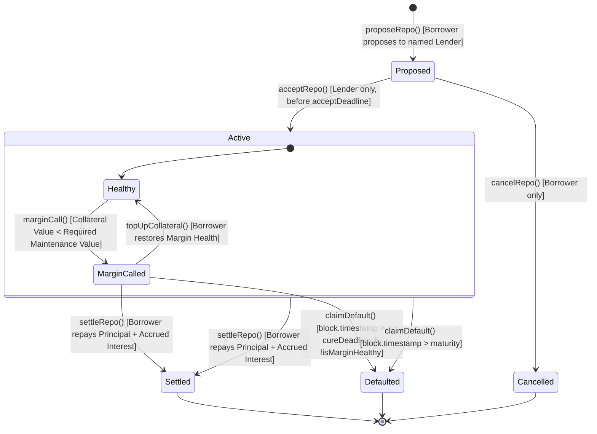

# Institutional DvP Repo Protocol: Architecture & Technical Specification

**Client:** Nordhaven Bank (European G-SIB)  
**Author:** Lead Forward Deployed Engineer (FDE), Ethereum Institutional (EI)  
**Target Deployment:** Ethereum Sepolia Testnet  
**Target Solc:** `0.8.34` (EVM Version: Cancun) · `0.8.17` (ERC-3643 T-REX Suite)

---

## 1. Executive Summary & Business Context

Nordhaven Bank’s Treasury and Securities Financing desk operates an institutional bilateral and tri-party repurchase agreement (repo) book against European government bonds. In traditional financial market infrastructures (FMIs), this operation faces four structural bottlenecks:

1. **Settlement Latency & Rigid Market Cut-offs:** Settlement windows are strictly tied to TARGET2 and Euroclear/Clearstream operating hours, restricting intraday liquidity and collateral mobility.
2. **Counterparty & Settlement Failure Risk:** Fragmented clearing cycles where cash and collateral do not move simultaneously on a real-time gross basis (absence of true 24/7 atomic DvP Model 1).
3. **Manual Margin Management:** Mark-to-market calculations and margin call notices involve cumbersome multi-hour operational lags and manual collateral reconciliation.
4. **Trapped Inventory:** High-Quality Liquid Assets (HQLA) sovereign bonds remain stranded in designated clearing silos instead of being mobilized dynamically for intraday liquidity.

This architecture specifies a **24/7, atomic Delivery-versus-Payment (DvP) repurchase agreement engine on public Ethereum (Sepolia)**. It targets a lean, auditable Proof of Concept (POC) built around four institutional components:

- **Collateral Leg (`nhBOND` / `nhBOND NAV`):** Strictly implemented using the official **ERC-3643 (T-REX)** token standard, representing a tokenised European sovereign government bond (German Bund ISIN `DE0001102580`, €100.00 par, 2.50% coupon, Level 1 HQLA) valued on-chain at continuous Net Asset Value / mark-to-market price (**`nhBOND NAV`**), incorporating on-chain identity verification (`ONCHAINID`), claim topics, and modular compliance rules.
- **Cash Leg (`nhEUR`):** Structured as a **Tokenised Commercial Bank Deposit** modeled after **J.P. Morgan’s JPM Coin (`JPMD`)** (deployed on Ethereum Mainnet at `0xb2906cCED1b2c8330480414CeFA1eb52bDBd73A3`), featuring role-based banking controls, shared ERC-3643 identity verification, account freeze/pause guardrails, and EIP-2612 permit support.
- **Bond Price / NAV Oracle (`nhNAVOracle`):** A Net Asset Value / bond price oracle modeling the calculation-agent attestation pattern used by institutional tokenised fixed-income instruments (**BlackRock BUIDL**, **Ondo OUSG**, and **VanEck VBILL**), exposing Chainlink’s `AggregatorV3Interface` with calculation agent attestation and round timestamps (`updatedAt`).
- **Settlement & Escrow Engine (`RepoDvP`):** Operating as an automated decentralized tri-party collateral agent with on-chain bilateral proposal and acceptance, dynamic opening collateral sizing capped by `maxCollateralAmount`, Actual/360 per-second money market interest accrual, programmable margin calls, and close-out netting on default.

---

## 2. System Architecture & Topology

```
                                  Institutional Trading & Settlement Layer
    ┌─────────────────────────────────────────────────────────────────────────────────────────────────┐
    │                                                                                                 │
    │     [ Bank A Trading Desk ]                                         [ Bank B Trading Desk ]     │
    │     (Cash Borrower / Pledgor)                                       (Cash Lender / Buyer)       │
    │                │                                                               │                │
    │                │  1. Propose repo trade on-chain via proposeRepo()             │                │
    │                └───────────────────────────────┬───────────────────────────────┘                │
    │                                                │                                                │
    │                                                │ 2. Submits acceptRepo() before acceptDeadline  │
    │                                                ▼                                                │
    │                              ┌───────────────────────────────────┐                              │
    │                              │            RepoDvP.sol            │                              │
    │                              │     (Settlement & Escrow)         │                              │
    │                              └─┬───────────────┬───────────────┬─┘                              │
    │                                │               │               │                                │
    └────────────────────────────────┼───────────────┼───────────────┼────────────────────────────────┘
                                     │               │               │
       Live Identity Registry Checks │               │ Mark-to-Market│ Atomic Cash & Collateral DvP
                                     ▼               ▼               ▼
                       ┌───────────────────┐   ┌───────────┐   ┌────────────────────────────┐
                       │ IdentityRegistry  │   │ nhNAV     │   │ nhBOND NAV (Pure ERC-3643) │
                       │ (ONCHAINID / KYC) │   │ Oracle    │   │ nhEUR (JPM Coin Model)     │
                       └───────────────────┘   └───────────┘   └────────────────────────────┘
```

### Component Breakdown:

1. **Collateral Token (`nhBOND.sol` - Authentic ERC-3643 / T-REX Framework):**
   - Derives directly from the authentic open-source **`lib/ERC-3643`** implementation (`Token.sol:Token`, compiled under `solc 0.8.17`).
   - Represents a tokenised European sovereign government bond (10Y German Bund ISIN `DE0001102580`, €100.00 par, 2.50% coupon) marked to market via its continuous Net Asset Value / dirty price (**`nhBOND NAV`**). Token Name: `Nordhaven Sovereign Bond NAV`, Symbol: `nhBOND NAV`.
   - Adds sovereign bond master metadata (`isin`, `maturityDate`, `couponRateBps`, `navOracle`) and agent-controlled primary market lifecycle methods (`issue`, `redeem`).
   - Connected to the official T-REX compliance suite:
     - **`IdentityRegistry` (`IIdentityRegistry`):** Maps counterparty Ethereum addresses to their respective on-chain digital identities (`ONCHAINID`).
     - **`ModularCompliance` (`IModularCompliance`):** Enforces transfer restrictions and investor eligibility before any transfer executes.
     - **`ClaimTopicsRegistry` & `TrustedIssuersRegistry`:** Manages required KYC claim topics and trusted claim issuers.
     - **Regulatory Controls:** Supports address freezing, partial token freezing (`freezePartialTokens`), forced regulatory transfers (`forcedTransfer`), and wallet recovery (`recoveryAddress`).

2. **`nhEUR.sol` (Tokenised Euro Commercial Bank Deposit - JPM Coin Architecture):**
   - Modeled after **J.P. Morgan's JPM Coin (`JPMD`)** (`0xb2906cCED1b2c8330480414CeFA1eb52bDBd73A3` on Ethereum Mainnet) and **SocGen-FORGE's `EURCV`**.
   - Organised into a **4-Tier Institutional Banking Architecture**:
     - _Tier 1: Base Fungibility Layer:_ ERC-20 + `ERC20Permit` (EIP-2612) for standard institutional token operations.
     - _Tier 2: Authorized Account Registry:_ Queries the ERC-3643 `IdentityRegistry` (`isVerified`) in `_update()` on every mint, burn, and transfer, and exposes `identityRegistry()` so `RepoDvP` can verify counterparties dynamically.
     - _Tier 3: Core Banking Clearing Gateway:_ Role-based `mint` and `burn` (`TREASURY_ROLE`) tied to fiat settlements in RTGS / TARGET2, emitting banking reconciliation references (`fiatReference`).
     - _Tier 4: Supervisory Compliance & Circuit Breakers:_ Account-level asset freeze (`setFrozen` under `COMPLIANCE_ROLE`) and emergency contract-wide pause/unpause circuit-breakers (`pause` / `unpause`).

3. **`nhNAVOracle.sol` (RWA Sovereign Bond Fund NAV Oracle):**
   - Models the NAV oracle pattern utilized by institutional tokenised funds (**BlackRock BUIDL**, **Ondo Finance OUSG**, and **VanEck VBILL**).
   - Implements Chainlink's **`AggregatorV3Interface`** (`latestRoundData`, `decimals() == 8`).
   - Ingests certified Net Asset Value (NAV) updates (`updateNAV(int256 navEur)`) submitted by an authorized institutional **Calculation Agent / Fund Administrator** holding `CALCULATION_AGENT_ROLE`.
   - Records `_roundId` and `_updatedAt` on every attestation so downstream consumers, off-chain risk engines, or peripheral routers can monitor price freshness.

4. **`RepoDvP.sol` (Core Settlement & Escrow Engine):**
   - Manages the full lifecycle of bilateral repurchase agreements between two verified institutional counterparties.
   - Operates as an automated **Tri-Party Escrow Agent** under Directive 2002/47/EC (EU Financial Collateral Directive).
   - Queries each leg's `identityRegistry()` live (`IIdentityRegistryBound(collateralToken).identityRegistry()` and `IIdentityRegistryBound(cashToken).identityRegistry()`) at proposal time, ensuring compliance even if either token rotates its registry.
   - Sizes opening collateral dynamically at acceptance time from the live oracle NAV price (bounded by the borrower's `maxCollateralAmount` cap), accrues Actual/360 interest per second, manages margin calls and top-up cures, and executes **close-out netting** on default.

---

## 3. Institutional Standards & Legal Framework Alignment

### 3.1 Cash Leg Justification: Tokenised Commercial Bank Deposit vs. Alternatives

- **Why Stablecoins Fail for G-SIBs:** Commercial stablecoins (MiCA EMTs) are liabilities of third-party non-bank Electronic Money Institutions (EMIs). In interbank sovereign repo:
  1. _Credit Risk:_ Lending €100M of risk-free German Bunds against an uncollateralized claim on a private EMI introduces unacceptable private credit and reserve bank contagion risk.
  2. _CPMI-IOSCO PFMI Principle 9 Violation:_ Financial market infrastructures must settle payments in Central Bank Money (CeBM) or creditworthy Commercial Bank Money (CoBM). Retail stablecoins fail this principle.
  3. _LCR & Capital Penalty:_ Sovereign bonds are Level 1 High-Quality Liquid Assets (HQLA) with 0% risk weight. Stablecoins are disqualified from Level 1 HQLA under CRR/Basel III and attract punitive risk weights, penalizing the trading desk’s Liquidity Coverage Ratio.
- **Why Wholesale CBDC (wCBDC) is Premature for 24/7 Production:** Although the Banque de France and Deutsche Bundesbank demonstrated wCBDC settlement in the 2024 Eurosystem DLT trials, the European Central Bank does not yet operate a permanent, live 24/7 public Ethereum wCBDC.
- **The Selected Standard: Tokenised Commercial Bank Deposit (`nhEUR`):** Tokenised commercial bank deposits represent direct 1:1 deposit claims on Nordhaven Bank under European banking law (CRR/CRD). For Phase 1 pilot trades (intra-group entities or clients holding Nordhaven correspondent accounts), `nhEUR` settles instantly on-chain without MiCA EMT friction, while the standard `IERC20` cash interface allows seamless future migration to an ECB wCBDC or multi-bank shared deposit ledger (BIS Project Agorá).

### 3.2 Collateral Custody: Smart Contract Escrow (Tri-Party Equivalence)

- In traditional bilateral repo (GMRA), legal title transfers to the lender. However, if the lender rehypothecates the bond on-chain, closing-leg settlement (RvP) becomes vulnerable to delivery failures.
- Under **Smart Contract Escrow**:
  - The `RepoDvP` contract acts as a neutral, programmatic tri-party collateral agent.
  - Collateral is locked at trade inception (`acceptRepo`) and released **strictly upon full repayment** (`settleRepo`) or **netted and seized strictly upon verified default** (`claimDefault`).
  - Under the **EU Financial Collateral Directive (Directive 2002/47/EC)**, locking tokens in an immutable escrow contract where the borrower gives up unilateral control satisfies the dispossession/control requirement for a Security Financial Collateral Arrangement, while close-out netting returns any excess collateral value above the repurchase price to the borrower.

---

## 4. State Machine & Trade Lifecycle



### State Definitions:

- `None`: Trade does not exist (`repoId` not initialized).
- `Proposed`: On-chain proposal created by the borrower for a designated lender; valid until `acceptDeadline`. No tokens are locked yet.
- `Active`: Opening leg executed via atomic DvP. Collateral held in `RepoDvP` escrow; cash delivered to borrower. Interest accrues per second.
- `MarginCalled`: Active trade flagged because collateral mark-to-market value fell below the maintenance margin requirement. `cureDeadline` timer is active.
- `Settled`: Closing leg completed via atomic RvP. Cash principal plus accrued interest repaid to lender; escrowed collateral returned to borrower.
- `Defaulted`: Borrower failed to repay by `maturity` or failed to cure a margin call by `cureDeadline`. Close-out netting transfers collateral worth `amountOwed` to the lender and returns any `surplusCollateral` to the borrower.
- `Cancelled`: Proposal withdrawn by the borrower prior to lender acceptance.

---

## 5. Financial Mathematics & Day-Count Convention

### 5.1 Day-Count Convention: Actual/360

European repo and money markets use the **Actual/360** convention. Interest is calculated based on exact elapsed seconds relative to a 360-day year ($360 \times 86,400 = 31,104,000\text{ seconds}$):

$$\text{Interest} = \left\lfloor \frac{\text{Borrow Amount} \times \text{Repo Rate (bps)} \times \Delta t_{\text{seconds}}}{360 \times 86,400 \times 10,000} \right\rfloor = \left\lfloor \frac{\text{Borrow Amount} \times \text{Repo Rate (bps)} \times \Delta t_{\text{seconds}}}{311,040,000,000} \right\rfloor$$

Where:

- $\text{Borrow Amount}$: Cash principal borrowed, in 18 decimals (`nhEUR`).
- $\text{Repo Rate (bps)}$: Annualized repo rate where $1\text{ bps} = 0.01\%$ (e.g., `350` = $3.50\%$).
- $\Delta t_{\text{seconds}}$: $\max(0,\ \text{block.timestamp} - \text{startTime})$, supporting intraday repos down to 1 second.

$$\text{Current Repurchase Price} = \text{Borrow Amount} + \text{Interest}$$

### 5.2 Initial Margin & Opening Collateral Sizing

At proposal time, the borrower specifies an initial margin buffer $m_{\text{init}}$ (in basis points, up to `MAX_INITIAL_MARGIN_BPS = 5,000` / $50\%$) and a slippage protection cap `maxCollateralAmount`. When the lender calls `acceptRepo()`, the required collateral is sized at the live oracle NAV price (8 decimals, `collateralOraclePrecision` $= 10^8$):

$$\text{Required Initial Collateral Value (EUR)} = \left\lfloor \frac{\text{Borrow Amount} \times (10,000 + m_{\text{init}})}{10,000} \right\rfloor$$

$$\text{Required Initial Collateral Units} = \left\lceil \frac{\text{Required Initial Collateral Value (EUR)} \times 10^8}{\text{Oracle NAV Price}} \right\rceil$$

**Validation Guard on Acceptance:**
$$\text{Required Initial Collateral Units} \le \text{maxCollateralAmount}$$
If the bond price has dropped since proposal such that required units exceed `maxCollateralAmount`, `acceptRepo()` reverts with `RequiredCollateralAboveCap(requiredCollateral, maxCollateralAmount)`.

### 5.3 Maintenance Margin & Margin Calls

During the life of the repo, the current collateral value and required maintenance value are computed dynamically against the accruing repurchase price and the agreed maintenance margin $m_{\text{maint}}$ (`maintenanceMarginBps <= initialMarginBps`):

$$\text{Current Collateral Value (EUR)} = \left\lfloor \frac{\text{Collateral Units} \times \text{Oracle NAV Price}}{10^8} \right\rfloor$$

$$\text{Required Maintenance Value (EUR)} = \left\lfloor \frac{\text{Current Repurchase Price} \times (10,000 + m_{\text{maint}})}{10,000} \right\rfloor$$

A position is healthy (`isMarginHealthy(repoId) == true`) when:

$$\text{Current Collateral Value (EUR)} \ge \text{Required Maintenance Value (EUR)}$$

If $\text{Current Collateral Value} < \text{Required Maintenance Value}$:

- Anyone can call `marginCall(repoId)` on an `Active` repo, transitioning status to `MarginCalled` and setting `cureDeadline = block.timestamp + curePeriodSeconds`.
- The borrower can call `topUpCollateral(repoId, topUpAmount)` to transfer additional `nhBOND` into escrow. If `isMarginHealthy(repoId)` is restored, the repo automatically returns to `Active` and `cureDeadline` resets to `0`.

### 5.4 Default Close-Out Netting

If (`(status == Active || status == MarginCalled) && block.timestamp > maturity`) or (`status == MarginCalled && block.timestamp > cureDeadline && !isMarginHealthy(repoId)`), the lender can call `claimDefault(repoId)`. Consistent with GMRA close-out netting principles, the lender seizes collateral worth the exact `amountOwed` (`getCurrentRepurchasePrice(repoId)`), rounded up in the lender's favor, and any surplus collateral is returned to the borrower in the same transaction:

$$\text{Seized Collateral Units} = \min\left(\text{Collateral Units},\ \left\lceil \frac{\text{Current Repurchase Price} \times 10^8}{\text{Oracle NAV Price}} \right\rceil\right)$$

$$\text{Surplus Collateral Units} = \text{Collateral Units} - \text{Seized Collateral Units}$$

---

## 6. Contract Interfaces & Data Structures

### 6.1 RWA Fund NAV Oracle Interface (`src/interfaces/InhNAVOracle.sol`)

```solidity
// SPDX-License-Identifier: MIT
pragma solidity 0.8.34;

/// @notice Chainlink AggregatorV3Interface standard
interface AggregatorV3Interface {
  function decimals() external view returns (uint8);
  function description() external view returns (string memory);
  function version() external view returns (uint256);
  function latestRoundData()
    external
    view
    returns (
      uint80 roundId,
      int256 answer,
      uint256 startedAt,
      uint256 updatedAt,
      uint80 answeredInRound
    );
}

/// @title  InhNAVOracle
/// @notice Minimal Chainlink AggregatorV3-compatible NAV oracle interface.
/// @dev    Exposes `updatedAt` via `latestRoundData()` for off-chain monitors or consumers that enforce staleness.
interface InhNAVOracle is AggregatorV3Interface {
  event NAVSubmitted(uint80 indexed roundId, int256 navEur, uint256 updatedAt);

  error InvalidNAV();
  error ZeroAddress();

  /// @notice Publishes a positive NAV per share (EUR, 8 decimals, e.g. 100_00000000 = €100.00).
  /// @dev    Reverts with `InvalidNAV` if `navEur <= 0`.
  function updateNAV(int256 navEur) external;
}
```

---

### 6.2 Core Data Structures (`src/RepoDvP.sol`)

```solidity
/// @notice Lifecycle status of a repo agreement.
enum RepoStatus {
  None,
  Proposed,
  Active,
  MarginCalled,
  Settled,
  Defaulted,
  Cancelled
}

/// @notice Terms of a repo agreement, fixed at proposal.
struct RepoOrder {
  address borrower;
  address lender;
  uint256 borrowAmount;
  uint32 repoRateBps;
  uint32 initialMarginBps;
  uint32 maintenanceMarginBps;
  uint32 termSeconds;
  uint32 curePeriodSeconds;
  uint40 acceptDeadline;
  uint256 maxCollateralAmount;
}

/// @notice Dynamic operational and settlement state of a repo agreement.
struct RepoState {
  RepoStatus status;
  uint256 collateralAmount;
  uint40 startTime;
  uint40 maturity;
  uint40 cureDeadline;
}
```

---

### 6.3 Core Settlement Engine Interface (`src/interfaces/IRepoDvP.sol`)

```solidity
// SPDX-License-Identifier: MIT
pragma solidity 0.8.34;

interface IRepoDvP {
  /* ============ Events ============ */

  event RepoProposed(
    uint256 indexed repoId,
    address indexed borrower,
    address indexed lender,
    uint256 borrowAmount,
    uint256 maxCollateralAmount,
    uint32 repoRateBps,
    uint32 termSeconds
  );

  event RepoOpened(
    uint256 indexed repoId,
    address indexed borrower,
    address indexed lender,
    uint256 borrowAmount,
    uint256 collateralAmount,
    uint40 startTime,
    uint40 maturity
  );

  event RepoSettled(
    uint256 indexed repoId,
    uint256 totalRepaid,
    uint256 collateralReturned,
    uint40 settlementTimestamp
  );

  event MarginCalled(
    uint256 indexed repoId,
    uint256 currentCollateralValue,
    uint40 cureDeadline
  );

  event MarginToppedUp(
    uint256 indexed repoId,
    uint256 additionalCollateral,
    uint256 newTotalCollateral
  );

  event RepoDefaulted(
    uint256 indexed repoId,
    address indexed lender,
    uint256 amountOwed,
    uint256 collateralSeized,
    uint256 surplusCollateral,
    string reason
  );

  event RepoCancelled(uint256 indexed repoId, address indexed proposer);

  /* ============ Custom Errors ============ */

  error ZeroPriceOracle();
  error ZeroCollateralToken();
  error ZeroCashToken();
  error ZeroAmount();
  error Unauthorized();
  error NotKYCVerified(address account);
  error InvalidLender();
  error RequiredCollateralAboveCap(
    uint256 requiredCollateral,
    uint256 maxCollateralAmount
  );
  error MarginSufficient();
  error InitialMarginInvalid();
  error TermInvalid();
  error CurePeriodInvalid();
  error MaintenanceMarginInvalid();
  error AcceptDeadlineInvalid();
  error ProposalExpired(uint256 acceptDeadline, uint256 currentTimestamp);

  /* ============ Interactive Functions ============ */

  function proposeRepo(
    address lender,
    uint256 borrowAmount,
    uint32 repoRateBps,
    uint32 initialMarginBps,
    uint32 maintenanceMarginBps,
    uint32 termSeconds,
    uint32 curePeriodSeconds,
    uint256 maxCollateralAmount,
    uint40 acceptDeadline
  ) external returns (uint256 repoId);

  function acceptRepo(uint256 repoId) external;
  function settleRepo(uint256 repoId) external;
  function marginCall(uint256 repoId) external;
  function topUpCollateral(uint256 repoId, uint256 topUpAmount) external;
  function claimDefault(uint256 repoId) external;
  function cancelRepo(uint256 repoId) external;

  /* ============ View Functions ============ */

  function getCurrentRepurchasePrice(
    uint256 repoId
  ) external view returns (uint256);
  function getRepoInterest(
    uint256 repoId
  ) external view returns (uint256 interest);
  function getCollateralPrice() external view returns (uint256 price);
  function getCollateralValue(
    uint256 repoId
  ) external view returns (uint256 collateralValueEUR);
  function getRequiredCollateralValue(
    uint256 repoId
  ) external view returns (uint256);
  function getRequiredCollateralAmount(
    uint256 repoId
  ) external view returns (uint256);
  function isMarginHealthy(uint256 repoId) external view returns (bool);

  function repoCount() external view returns (uint256);
  function collateralToken() external view returns (address);
  function cashToken() external view returns (address);
  function collateralOracle() external view returns (address);
  function collateralOraclePrecision() external view returns (uint256);
}
```

---

## 7. Back-Office Reconciliation & Audit Telemetry

In institutional banking, every state transition must map to OMS/EMS (Order Management Systems) and core banking subledgers (e.g., Murex, Calypso, SAP Core Banking).

### Event-to-Subledger Mapping:

| On-Chain Event   | Traditional Banking Message                                           | Subledger Impact                                                                                                                   |
| :--------------- | :-------------------------------------------------------------------- | :--------------------------------------------------------------------------------------------------------------------------------- |
| `RepoProposed`   | `MT598` / `ISO 20022 sese.023`                                        | Trade proposal booked off-balance-sheet; pending lender acceptance before `acceptDeadline`.                                        |
| `RepoOpened`     | `MT541` (Receive Against Payment) & `MT543` (Deliver Against Payment) | Leg 1 atomic DvP executed. Cash transferred Lender $\rightarrow$ Borrower; Collateral locked in `RepoDvP` escrow.                  |
| `MarginCalled`   | `Margin Call Notice` (ISO 20022 `colr.003`)                           | Mark-to-market collateral deficit flagged; `cureDeadline` countdown initiated in risk engine.                                      |
| `MarginToppedUp` | `Collateral Proposal / Transfer` (ISO 20022 `colr.007`)               | Additional `nhBOND` units credited to escrow; position restored to `Active` once maintenance threshold is met.                     |
| `RepoSettled`    | `MT541/543` Closing Leg Settlement                                    | Leg 2 atomic RvP executed. Borrower repays Principal + Actual/360 Interest; collateral released from escrow.                       |
| `RepoDefaulted`  | `Default & Close-Out Netting Notice`                                  | Close-out netting executed: `collateralSeized` (worth `amountOwed`) delivered to Lender; `surplusCollateral` returned to Borrower. |
| `RepoCancelled`  | `Trade Cancellation Notice` (`sese.020`)                              | Unaccepted proposal cancelled by Borrower prior to execution.                                                                      |

---

## 8. Invariant Testing Matrix & Formal Verification Rules

For Foundry invariant testing (`test/invariant/`), the following mathematical and state invariants are continuously verified across arbitrary call sequences:

1. **Escrow Solvency Invariant (`invariant_EscrowSolvency`):**
   $$\text{nhBOND.balanceOf}(\text{address(RepoDvP)}) == \sum_{i \in \text{OpenRepos}} \text{states}[i].\text{collateralAmount}$$
   _The contract always holds the exact sum of collateral pledged across all active and margin-called repos._

2. **No Trapped Cash Invariant (`invariant_ZeroTrappedCash`):**
   $$\text{nhEUR.balanceOf}(\text{address(RepoDvP)}) == 0$$
   _The settlement contract never custodies cash. Cash flows directly from lender $\rightarrow$ borrower at Leg 1, and borrower $\rightarrow$ lender at Leg 2._

3. **Settlement Atomicity Invariant:**
   _In `acceptRepo` and `settleRepo`, if either token leg fails (insufficient balance, missing allowance, frozen wallet, or revoked KYC), the entire transaction reverts atomically._

4. **Default Legitimacy & Close-Out Netting Invariant:**
   _`claimDefault(repoId)` cannot succeed unless (`status == Active && block.timestamp > maturity`) or (`status == MarginCalled && block.timestamp > cureDeadline && !isMarginHealthy(repoId)`), and never seizes more collateral units than $\lceil \text{amountOwed} \times 10^8 / \text{price} \rceil$._

5. **Permissioning Invariant:**
   _No address lacking verification in both tokens' ERC-3643 `IdentityRegistry` contracts can propose, accept, or receive `nhBOND` or `nhEUR`._

---

## 9. Architectural Notes & Peripheral Extensions

To keep the core `RepoDvP.sol` state machine lean, gas-efficient, and straightforward to audit, optional workflow accelerators—such as **off-chain EIP-712 signed order matching (`executeRepoOrder`)** and **inline EIP-2612 permit wrappers (`acceptProposalWithPermit` / `settleRepoWithPermit`)**—are intentionally decoupled from the core escrow contract into peripheral router patterns. For reference implementations and design rationale, see [ARCHITECTURAL_NOTES.md](file:///Users/toni/EI/repo-case/evm-dvp-repo/docs/ARCHITECTURAL_NOTES.md).
